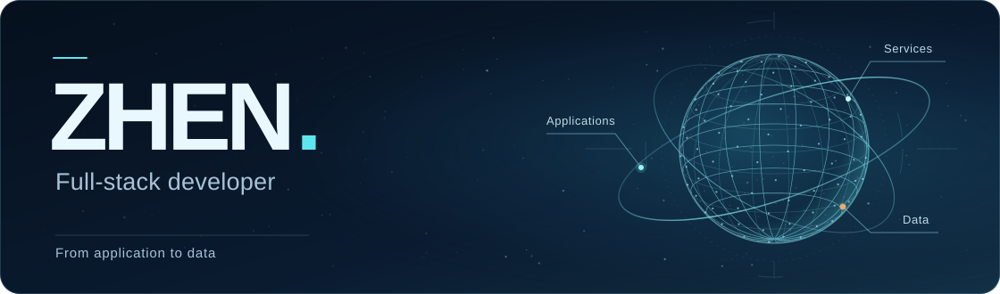

[简体中文](readme.md) · **English**

# Zezhen Cao · ZHEN

**Full-stack developer | WeChat Mini Programs, Java / Node.js / Python**

I've worked on scenic-area ticketing, outdoor event management, and knowledge services, building mini programs, admin dashboards, APIs, and database workflows. The projects below show how I handle transaction consistency, event operations, and geospatial analysis.

**[View portfolio](https://zhen666555-sketch.github.io/)** · [GitHub](https://github.com/zhen666555-sketch) · [Email](mailto:zhen666555@gmail.com)

## Selected projects

### [Longqingxia | Scenic-area ticketing platform](https://zhen666555-sketch.github.io/#longqingxia)

*Internship project at Beijing Fei'erdisi · WeChat Mini Programs / Java 21 / Spring Boot / MySQL*

**22 requests down to 1.** In a regression scenario with 20 orders per page, used stored order snapshots and a batch summary endpoint to consolidate requests. Historical orders remained accessible when the product API failed.

Integrated WeChat Pay and a third-party ticketing provider. Issued tickets after server-side payment confirmation, handled callback retries with idempotency keys and persistent tasks, and kept remaining tickets valid after partial refunds.

### [Yeyixia | Outdoor event management platform](https://zhen666555-sketch.github.io/#yeyixia)

*Internship project at Beijing Fei'erdisi · WeChat Mini Programs / Node.js / MySQL / Tencent Cloud COS*

**7 core relational tables.** Migrated JSON snapshots to MySQL and used unique constraints, transactions, and version checks to prevent duplicate registrations and conflicting writes.

Connected organizer onboarding, event review, registration, insurance records, check-in, and completion review. Event edits went through a separate review; fee changes prompted participants to reconfirm their registration. The refund workflow records and reviews requests only.

### [Bike-share and metro transfer analysis](https://zhen666555-sketch.github.io/#bike-transit)

*Graduation project · Full-stack development · Nov 2025 – Apr 2026 · Flask / GeoPandas / XGBoost*

**236 physical stations and approximately 1.36 million points of interest.** Combined station and POI data with existing bike-share trip summaries to build station-by-hour transfer features, then presented the results with maps and charts.

Split training and test data by physical station and fitted scaling parameters within each training fold. Compared OLS and XGBoost, then used SHAP and partial dependence plots to explain the models' behavior.

## Internships

### Beijing Fei'erdisi Network Media (北京菲尔迪斯网络传媒有限公司)

**Full-stack developer intern | Aug 2026 – Present**

- Contributed to the Longqingxia ticketing rebuild and ongoing Yeyixia development across WeChat Mini Programs, admin dashboards, and backend APIs.
- Worked on payment confirmation, asynchronous ticket issuance, partial refunds, and re-registration after event changes. Used idempotency, business snapshots, and transaction constraints to keep order and registration states consistent.
- Contributed to regression testing, Tencent Cloud deployments, rollback preparation, backup verification, and recovery drills. Tracked backend and dashboard deployments separately from WeChat development builds.

### Jingrui Technology (晶锐科技有限公司)

**Full-stack developer intern | Mar 2026 – Jun 2026**

- Built Vue 3 and Pinia pages and Flask-RESTX endpoints for the Jingliao Zhihu platform, covering knowledge retrieval, rule-based recommendations, and nursing records.
- Contributed to Neo4j relationship modeling, MongoDB record queries, and the RAG pipeline, with support for session renewal, paginated filters, and caching.

## Additional projects

### [Jingliao Zhihu | IV therapy knowledge graph and Q&A](https://zhen666555-sketch.github.io/#iv-therapy)

*Internship project at Jingrui Technology · Vue 3 / Flask / Neo4j / MongoDB / RAG*

- Split reference documents into chunks with source metadata. Combined keyword, vector, and graph retrieval, then deduplicated and ranked results before assembling model context. The backend returns source references through standard query and server-sent event (SSE) endpoints.
- Contributed to catheter recommendation rules and nursing-record APIs, connecting form inputs, rule results, and persistent records. Some front-end Q&A views remain demonstrations.

### [Zhixing Fajian | AI mini program for traffic-law information](https://zhen666555-sketch.github.io/#zhixing)

*Full-stack development (mini program and cloud functions) · Oct 2025 – Dec 2025 · WeChat Mini Programs / CloudBase / Node.js / DeepSeek API*

- Sent accident descriptions to a model through cloud functions and parsed responses into case summaries, legal references, and suggested next steps. Distinguished model responses from cloud fallback guidance and offline examples, and handled loading and scrolling in the chat UI.

### [Youlin Community | HarmonyOS property services app](https://zhen666555-sketch.github.io/#harmony-community)

*Mobile development · Jan 2025 – Apr 2025 · ArkTS / ArkUI / Stage / UIAbility*

- Built 20 screens with ArkUI, with shared HTTP requests, authentication token handling, and page state. Integrated APIs for property notices, parcel pickup, housekeeping bookings, and resident feedback.

### [Grocery shopping mini program](https://zhen666555-sketch.github.io/#shopping)

*Mini program front end and Java backend collaboration · Nov 2024 – Jan 2025 · WeChat Mini Programs / Spring Boot / MyBatis / MySQL*

- Built product browsing, cart, and order lookup screens. Integrated product variant, order detail, and user APIs, and refreshed cart selections and quantities from the server after changes. Payment and refunds were outside the completed scope.

## Technical skills

- **Client:** WeChat Mini Programs, JavaScript, Vue 3, Pinia, Element Plus, ArkTS / ArkUI
- **Backend and data:** Java, Spring Boot, Spring Security, MyBatis, Node.js, Python, Flask, MySQL, Neo4j, MongoDB
- **Analytics and AI:** GeoPandas, NetworkX, OLS, XGBoost, SHAP / PDP, RAG, DeepSeek API
- **Testing and deployment:** Git, GitHub Actions, JUnit, Node.js testing, Tencent Cloud CVM / COS, Nginx, systemd

## About this repository

This repository contains the source for Zezhen Cao's portfolio and a bilingual résumé covering full-stack internships and project case studies. GitHub Pages hosts the live portfolio. To explore the responsive site and its optional deep-space Canvas animation locally, open `index.html` in a browser.
